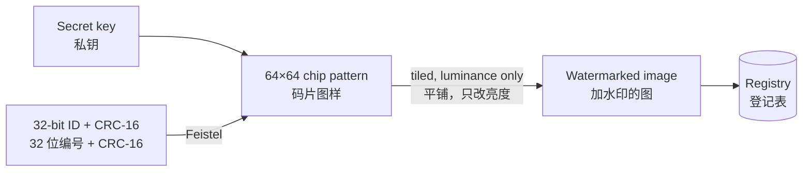

<div align="center">

# BlindMark

**Invisible, keyed watermarks that prove an image is yours — and show which copy leaked.**

**给图片加上肉眼看不见的水印，证明图片是你的，并查出是从哪一份流出去的。**

Runs entirely offline · Collects no data · Your images never leave your computer<br>
完全本地运行 · 不收集任何数据 · 图片不会离开你的电脑

[](https://github.com/lupo4085/blindmark/actions/workflows/build.yml)
[](https://github.com/lupo4085/blindmark/releases)

[](#license--许可证)

</div>


<p align="center"><sub>
Left: original. Middle: watermarked (PSNR 42.8 dB; no pixel changes by more than 6 luminance levels). Right: the difference, amplified 20×.<br>
左：原图。中：加水印后（PSNR 42.8 dB，像素最多改动 6 级亮度）。右：两者的差异放大 20 倍。
</sub></p>

> [!NOTE]
> The desktop app's interface is currently in Chinese; an English UI is planned for v0.4. The command-line tool works in any language.
>
> 桌面程序目前只有中文界面，英文界面计划在 v0.4 加入。命令行版不受语言影响。

---

## Contents · 目录

- [Why · 为什么做这个](#why--为什么做这个)
- [Features · 功能](#features--功能)
- [Live test · 实测](#live-test--实测)
- [Download and install · 下载和安装](#download-and-install--下载和安装)
- [Quick start · 快速上手](#quick-start--快速上手)
- [Desktop app · 图形界面](#desktop-app--图形界面)
- [Command line · 命令行](#command-line--命令行)
- [Benchmarks · 评测结果](#benchmarks--评测结果)
- [How it works · 原理](#how-it-works--原理)
- [Limitations · 局限](#limitations--局限)
- [Roadmap · 路线图](#roadmap--路线图)
- [Project layout · 目录结构](#project-layout--目录结构)
- [License · 许可证](#license--许可证)

## Why · 为什么做这个

Artists, photographers and designers who share their work run into two problems: someone reposts an image and there is no easy way to show it is yours, or a draft sent to several people leaks and there is no way to tell who shared it. Visible watermarks spoil the picture and disappear with a crop; online watermarking services need you to upload your originals.

画师、摄影师和设计师把图发出去以后，常常遇到两件事：图被人拿去用了，说不清是自己的；发给好几个人的稿子流出去了，不知道是谁传的。可见水印会破坏画面，而且一裁就掉；在线水印服务又要把原图上传到别人的服务器。

BlindMark takes a different approach · BlindMark 的做法是：

| English | 中文 |
|---|---|
| Hides an **invisible ID** that usually survives reposting, compression, screenshots and rotation | 在图片里加入**看不见的编号**，经过转发、压缩、截图、旋转后通常仍然能读出来 |
| **Only your key can read the ID**; without it, nobody can read or forge it | **编号只有你的密钥能读出**，别人拿不到密钥，就读不出、也伪造不了 |
| Every ID goes into your own **registry**: which original, when, and who it was for | 每个编号记在你自己的**登记表**里：哪张原图、什么时候、发给谁 |
| Everything runs locally: **no network, no uploads** | 所有处理都在本地完成，**不联网、不上传** |

## Features · 功能

| Feature · 功能 | Description · 说明 |
|---|---|
| **Keyed blind watermark**<br>带密钥的盲水印 | Detection needs only the key, not the original. One 32-bit ID per image, with a CRC check.<br>检测不需要原图，只要密钥。每张图一个 32 位编号，带 CRC 校验。 |
| **Near-lossless**<br>画质几乎无损 | Changes luminance only, with strength adapted to texture. Typical PSNR above 40 dB.<br>只改亮度通道，强度随纹理自适应，典型 PSNR 在 40 dB 以上。 |
| **Survives everyday handling**<br>扛得住常见处理 | JPEG / WebP compression, resizing, cropping, app UI frames, screenshots, any-angle rotation, mirroring.<br>JPEG / WebP 压缩、缩放、裁剪、加 App 界面边框、截图、任意角度旋转、镜像。 |
| **Registry**<br>登记表 | Records the original, note, time and thumbnail for each ID; searchable, exports to CSV.<br>记录每个编号对应的原图、备注、时间和缩略图，可搜索、导出 CSV。 |
| **Catches transplanted marks**<br>防“搬运”误判 | Compares the picture with the registered thumbnail to spot a mark moved onto another image.<br>检出编号后，把画面和登记的缩略图比对，发现有人把水印移到了别的图上。 |
| **One-click evidence export**<br>一键导出证据 | Report, SHA-256 of the suspect file, registered thumbnail and registry entry in one folder.<br>检测报告、可疑文件的 SHA-256、登记缩略图和登记记录打包到一个文件夹。 |
| **Getting-started wizard**<br>新手向导 | Walks you through creating a key, choosing a registry, watermarking and checking. Press F1 any time.<br>带你完成创建密钥、选择登记表、加水印、检查图片，随时按 F1 打开。 |
| **Native app**<br>原生程序 | Native Win32 UI on Windows (high-DPI aware); a single-binary CLI on all three platforms.<br>Windows 是原生 Win32 界面（支持高 DPI），三个平台都有单文件命令行版。 |
| **Python reference**<br>Python 参考实现 | Byte-for-byte compatible with the Rust build, with attack simulations and benchmark scripts.<br>和 Rust 版逐字节互通，自带攻击模拟和评测脚本。 |

**In development (v0.3):** per-recipient distribution (a separately numbered copy for each recipient) and optional trusted timestamps (off by default). Currently on the `alpha` branch.

**开发中（v0.3）**：接收人分发（给每位接收人生成一份独立编号的副本）、可选的可信时间戳（默认关闭）。目前在 `alpha` 分支。

## Live test · 实测

This illustration is only 441×512 pixels, much smaller than the photos in the benchmark set, which makes it a hard case for a blind watermark.

这张插画只有 441×512 像素，比评测集里的照片小很多，对盲水印来说是偏难的情况。

```console
$ blindmark-cli keygen --key demo.key
wrote demo.key (fingerprint a65eb21f65bd) — back it up, never share it

$ blindmark-cli embed lupo.png --out marked --key demo.key --registry reg --channel "README demo"
{"id":"0xe308fb2a","input":"lupo.png","output":"marked/lupo_wm.png","psnr_db":42.84,"sec":0.025}

$ blindmark-cli detect marked/lupo_wm.png --key demo.key --registry reg
{"found":true,"id_hex":"0xe308fb2a","method":"crc","z_sync":34.9,"content_similarity":0.99996, ...}

$ blindmark-cli detect lupo.png --key demo.key --registry reg      # original, no watermark · 没加水印的原图
{"found":false,"present":false, ...}
```

We applied the same attacks to both the watermarked image and the **unwatermarked original**, five random runs each.

对加水印的图和**没加水印的原图**各做同样的处理，每种处理随机跑 5 次。


| Attack · 处理 | Correct ID<br>识别出正确编号 | Wrong ID<br>认错编号 | False positives on original<br>原图误报 |
|---|---|---|---|
| None · 不处理 | 5/5 | 0 | 0/5 |
| JPEG quality 75 / 50 · JPEG 质量 75 / 50 | 5/5 / 5/5 | 0 | 0/10 |
| WebP quality 70 · WebP 质量 70 | 5/5 | 0 | 0/5 |
| Resize · 缩放 0.5× / 0.75× / 1.5× | 5/5 / 5/5 / 5/5 | 0 | 0/15 |
| Crop to 50% / 25% of the area · 裁剪，只保留 50% / 25% 面积 | 5/5 / 5/5 | 0 | 0/10 |
| App UI frame, gamma · 加 App 界面边框、调伽马 | 5/5 / 5/5 | 0 | 0/10 |
| Any-angle rotation (±30°) + JPEG 85 · 任意角度旋转 + JPEG 85 | 5/5 | 0 | 0/5 |
| Mirror, then screenshot · 左右镜像后再截图 | 5/5 | 0 | 0/5 |
| Screenshot, mild · 截图·轻度 | 5/5 | 0 | 0/5 |
| Screenshot, typical · 截图·常见<br><sub>45–100% zoom, 40–90% captured, JPEG 65–90 · 缩到 45–100%，截 40–90%，JPEG 65–90</sub> | 1/5 | 0 | 0/5 |
| Screenshot, harsh · 截图·严苛<br><sub>35–60% zoom, 30–60% captured, JPEG 55–75 · 缩到 35–60%，截 30–60%，JPEG 55–75</sub> | 0/5 | 0 | 0/5 |

**Result:** 14 of 16 attacks were read every time. Across all 80 tests on the original there were no false positives, and no run ever returned a wrong ID. The screenshot failures come from the image's small size: shrunk to about 200 pixels, each tile is only about 50 pixels across, which carries too little signal. Larger images do much better on screenshots (see [Benchmarks](#benchmarks--评测结果)).

**结论**：16 种处理里 14 种全部识别；原图 80 次测试全部零误报，也没有一次认错编号。截图失败的主要原因是这张图本来就小，再缩小到 200 像素左右，单个平铺块只剩 50 多像素，信息不够。原尺寸更大的图片在截图测试里表现好得多（见[评测结果](#benchmarks--评测结果)）。

The test images are in [`docs/images/`](docs/images/); the attacks are in [`python/attacks.py`](python/attacks.py).

测试用的原图和加水印后的图在 [`docs/images/`](docs/images/) 里，攻击函数在 [`python/attacks.py`](python/attacks.py)。

## Download and install · 下载和安装

### Prebuilt binaries · 直接下载（推荐）

Download the archive for your platform from [Releases](https://github.com/lupo4085/blindmark/releases).

到 [Releases](https://github.com/lupo4085/blindmark/releases) 下载对应平台的压缩包。

| Platform · 平台 | Contents · 包含 |
|---|---|
| Windows | `blindmark.exe` (desktop app · 图形界面), `blindmark-cli.exe` (command line · 命令行) |
| macOS / Linux | `blindmark-cli` (command line · 命令行) |

The binaries are not code-signed yet · 程序目前没有代码签名：

| Platform · 平台 | What to do · 处理方法 |
|---|---|
| Windows | If SmartScreen blocks it, click "More info" → "Run anyway".<br>SmartScreen 拦截时，点“更多信息”→“仍要运行”。 |
| macOS | `xattr -d com.apple.quarantine blindmark-cli` |
| macOS / Linux | Files from Actions artifacts lose the executable bit; run `chmod +x blindmark-cli`.<br>从 Actions 的 Artifacts 下载的文件会丢失可执行权限，先运行 `chmod +x blindmark-cli`。 |

### Build from source · 自己编译

Requires [Rust](https://rustup.rs) (2024 edition) · 需要 [Rust](https://rustup.rs)（2024 edition）。

```bash
git clone https://github.com/lupo4085/blindmark.git
cd blindmark
cargo build --release
# Windows: target\release\blindmark.exe, blindmark-cli.exe
# macOS / Linux: target/release/blindmark-cli
```

You can also fork the repo and run the `build` workflow from the Actions tab; binaries for all three platforms appear under Artifacts. Pushing a version tag (e.g. `v0.3.0`) publishes a Release automatically.

也可以 fork 仓库后在 Actions 页面运行 `build` 工作流，几分钟后在 Artifacts 里下载三个平台的程序。推一个版本标签（如 `v0.3.0`）会自动发布 Release。

## Quick start · 快速上手

**Windows desktop app · Windows 图形界面**

1. Open `blindmark.exe`. On first launch a wizard walks you through: create a key → choose where to keep the registry → **back up your key**.<br>
   打开 `blindmark.exe`。第一次启动会弹出向导：创建密钥 → 选择登记表位置 → **备份密钥**。
2. Choose "给图片加水印" (Watermark images), drop your pictures in and start. Watermarked copies are saved next to the originals by default.<br>
   选“给图片加水印”，把图片拖进去，点“开始加水印”。带水印的副本默认和原图放在同一个文件夹。
3. When you find a suspicious copy online, open the 检测 (Detect) tab and **paste a screenshot with Ctrl+V**, or drop the file in.<br>
   在网上发现可疑图片时，打开“检测”选项卡，**Ctrl+V 粘贴截图**，或者把文件拖进去。

**Command line · 命令行**

```bash
blindmark-cli keygen --key my.key
blindmark-cli embed photos/*.jpg --out marked/ --key my.key --registry reg/ --channel "Weibo"
blindmark-cli detect suspect.jpg --key my.key --registry reg/
```

> [!IMPORTANT]
> **Back up your key file and your registry folder.** If you lose the key, you can never read your existing watermarks again. Never share the key with anyone.
>
> **一定要备份密钥文件和登记表文件夹。** 丢了密钥，就再也读不出已经加过的水印。密钥不要发给任何人。

## Desktop app · 图形界面

A classic Win32 window with a menu bar, four tabs and a status bar (status · key fingerprint · registry size · version), with high-DPI and per-monitor scaling. Settings live in `%APPDATA%\blindmark\settings.json`; the key defaults to `%APPDATA%\blindmark\blindmark.key` and the registry to `registry\` in the same folder.

经典 Win32 窗口：菜单栏、四个选项卡、底部状态栏（当前状态 · 密钥指纹 · 登记表条数 · 版本），支持高 DPI 和多显示器缩放。设置保存在 `%APPDATA%\blindmark\settings.json`，密钥默认在 `%APPDATA%\blindmark\blindmark.key`，登记表在同目录的 `registry\`。

| Tab · 选项卡 | What it does · 作用 |
|---|---|
| **Watermark**<br>加水印 | Add images or folders (or drag them in); choose the output folder, a note (e.g. "Weibo", "for client X"), strength and PNG / JPEG. Batches run in the background and can be stopped.<br>添加图片或文件夹（可以直接拖进窗口），设置输出文件夹、备注（比如“微博”“发给某客户”）、强度、PNG / JPEG。后台批量处理，可以随时停止。 |
| **Detect**<br>检测 | Open, drop, or **paste a screenshot with Ctrl+V**. Shows the verdict, ID, note, original file, registration time, picture similarity and the registered thumbnail. Copy a report or export evidence.<br>打开、拖入，或者 **Ctrl+V 粘贴截图**。显示结论、编号、备注、原始文件、登记时间、画面相似度和登记缩略图。可以复制报告或导出证据。 |
| **Registry**<br>登记表 | Search and filter by ID, file name or note; sort by column; edit notes, open the output location, export CSV.<br>按编号、文件名、备注搜索和筛选，点列标题排序。可以修改备注、打开输出位置、导出 CSV。 |
| **Settings**<br>设置 | Key (new / choose / back up / remove), registry, watermark defaults, detection options, general options.<br>密钥（新建 / 选择 / 备份 / 移除）、登记表、加水印默认值、检测选项、常规选项。 |

**Five possible verdicts · 检测结果分五种：**

| Verdict · 结论 | Meaning · 含义 |
|---|---|
| Your watermark was found<br>找到你的水印 | Both the ID and the picture match.<br>编号和画面都对得上。 |
| ID matches, picture does not<br>编号对上了，但画面不一致 | Someone may have moved your watermark onto another image.<br>可能有人把你的水印搬到了另一张图上。 |
| Watermark present, ID unreadable<br>检测到水印，但无法确定是哪张 | Cropped too small or compressed too hard.<br>截得太小或压缩太狠。 |
| Picture matches, no watermark read<br>画面和登记的图一致，但没有读出水印 | Processed too heavily, or the unwatermarked original leaked.<br>处理得太狠，或者流出的是没加水印的原图。 |
| No watermark found<br>没有找到你的水印 | This does **not** prove the image isn't yours.<br>这**不能**证明图不是你的。 |

**Shortcuts · 快捷键：** F1 getting started · 开始使用（向导）；Ctrl+O add images · 添加图片；Ctrl+D detect · 检测图片；Ctrl+V detect from clipboard · 从剪贴板检测；Del remove selected · 移除所选；F5 refresh registry · 刷新登记表；Ctrl+1…4 switch tabs · 切换选项卡。

## Command line · 命令行

```text
blindmark-cli keygen --key <keyfile>
blindmark-cli embed  <images...> --out <dir> --key <keyfile> [--registry <dir>]
                     [--strength 2.6] [--channel <note>] [--jpeg]
blindmark-cli detect <images...> --key <keyfile> [--registry <dir>]
```

`embed` and `detect` print one JSON line per image, so they are easy to script.

`embed` 和 `detect` 每张图输出一行 JSON，方便接进脚本。

| Field · 字段 | Meaning · 含义 |
|---|---|
| `found` | A definite ID was read · 读出了确定的编号 |
| `id_hex` | The ID · 编号 |
| `present` | Signs of a watermark were found (ID may be unreadable) · 有水印存在的迹象（可能读不出具体编号） |
| `method` | `crc`: decoded directly · 直接解码；`registry`: matched against registered IDs · 在登记表里匹配 |
| `content_similarity` | Picture match against the registered thumbnail, 0–1, threshold 0.6 · 和登记缩略图的画面一致性，阈值 0.6 |
| `z_sync` | Sync signal strength · 同步信号强度 |

## Benchmarks · 评测结果

Simulated tests on 9 photos. The sample is small; treat the numbers as indicative.

9 张测试照片上的模拟测试，样本量不大，只作参考。

**Everyday handling · 常规处理**（4 random runs per attack · 每种随机跑 4 次）

| Attack · 处理 | Detection rate<br>识别率 | Wrong ID<br>认错编号 | False positives<br>原图误报 |
|---|---|---|---|
| JPEG q50/q75, WebP q70, resize · 缩放 0.5/0.75/1.5, gamma · 伽马, UI frame · 界面边框 | 100% | 0 | 0 |
| Crop to 50% / 25% · 裁剪保留 50% / 25% | 97% / 89% | 0 | 0 |
| Screenshot, mild / typical · 截图·轻度 / 常见 | 97% / 100% | 0 | 0 |
| Screenshot, harsh · 截图·严苛 | 33% | 0 | 0 |

**Rotation and mirroring · 旋转和翻转**（3 runs per attack · 每种跑 3 次）

| Attack · 处理 | Detection rate<br>识别率 | Wrong ID<br>认错编号 | False positives<br>原图误报 |
|---|---|---|---|
| Any-angle rotation + JPEG 85 · 任意角度旋转 + JPEG 85 | 89% | 0 | 0 |
| Resize, partial capture, frame, rotate ±20°, JPEG 80 · 缩放、截取、加边框，再旋转 ±20°，JPEG 80 | 82% | 0 | 0 |
| Mirror, then screenshot · 左右镜像后再截图 | 93% | 0 | 0 |

- **Picture consistency · 画面一致性：** genuine detections score above 0.78 (median 0.99); a transplanted watermark scores below 0.01.<br>正常检出的图在 0.78 以上，中位数 0.99；把水印移植到别的图上，结果低于 0.01。
- **Speed · 速度：** about 1.5 s to watermark a 24-megapixel photo; 1–2 s to detect, 3–4 s with rotation correction (dual-core machine).<br>2400 万像素的照片加水印约 1.5 秒；检测 1–2 秒，需要旋转校正时 3–4 秒（双核机器）。

## How it works · 原理



1. **Embedding · 嵌入**<br>
   The key generates a 64×64 grid of ±1 chips, half sync code and half payload (32-bit ID + CRC-16, Feistel-encrypted), tiled across the image with a period of about a quarter of the short side.<br>
   由私钥生成 64×64 的 ±1 码片网格，一半是同步码，一半承载载荷（32 位编号 + CRC-16，Feistel 加密），平铺到全图，周期约为短边的 1/4。
2. **Detection · 常规检测**<br>
   Autocorrelation gives the tile period (and so the scale); tiles are folded into one, aligned against the sync code, and decoded. If the CRC fails, the detector matches against registered IDs.<br>
   用自相关估计平铺周期（得到缩放比例），把各个周期折叠成一块，和同步码对齐后解码；CRC 不通过时，在登记过的编号里做最大似然匹配。
3. **Affine sync · 仿射同步**<br>
   A tiled watermark stays a 2-D lattice under rotation, scaling and shear. The lattice's basis vectors in the whitened autocorrelation give the transform; all 8 symmetries of the square tile are then tried.<br>
   平铺的水印在旋转、缩放、拉伸后仍然是二维点阵。从白化自相关图里找到点阵的两个基向量，就得到了变换；还原后把方块的 8 种对称姿态都试一遍。
4. **Picture consistency · 画面一致性**<br>
   The suspect image is aligned to the registered thumbnail; flat regions are skipped and the median block correlation is taken.<br>
   把可疑图对齐到登记缩略图，跳过平坦区域，取分块相关系数的中位数。

The `blindmark/v1` format is frozen: every future version will read watermarks made today.

水印格式 `blindmark/v1` 已冻结：以后任何版本都能读出现在加的水印。

## Limitations · 局限

| English | 中文 |
|---|---|
| The periodic structure from tiling can be found without the key; a determined attacker can average the tiles within one image to estimate and remove the mark. | 平铺带来的周期结构，没有密钥也能被发现；懂行的人可以在单张图内把各块叠加平均来估计并去除水印。 |
| Does not survive AI redraws or style transfer. | 不抗 AI 重绘、风格迁移。 |
| Photos taken of a screen are **not supported** yet. | **暂不支持**对着屏幕拍摄的照片。 |
| Small images shrunk heavily cannot be read (see the live test). | 很小的图在被大幅缩小后读不出来（见上面的实测）。 |
| Very dark images with large flat areas can fail when also stretched or sheared. | 很暗、大片纯色的图片在同时被拉伸或错切时容易失败。 |
| A watermark is one piece of evidence, not all of it. Keep the original, the registry and the detection results. | 水印是证据之一，不是全部。主张所有权时，要同时保留原图、登记表和检测结果。 |

## Roadmap · 路线图

- [x] v0.2: Win32 desktop app, affine sync (rotation / mirroring) · Win32 图形界面、仿射同步（旋转 / 镜像）
- [x] v0.3-alpha: getting-started wizard · 新手向导
- [ ] v0.3: per-recipient distribution, optional trusted timestamps, mnemonic key backup, calibrated false-positive rate · 接收人分发、可选的可信时间戳、密钥助记词备份、经过标定的误报率
- [ ] v0.4: English UI, web detector (WASM; images never uploaded), winget / Scoop · 英文界面、网页版检测器（WASM，图片不上传）、winget / Scoop
- [ ] v0.5: optional neural detection boost (ONNX, CPU only) · 可选的神经网络增强检测（ONNX，只用 CPU）

## Project layout · 目录结构

```text
src/keys.rs       key derivation, chip patterns, payload encryption · 密钥派生、码片图样、载荷加密
src/wm.rs         embedding and standard detection · 嵌入与常规检测
src/affine.rs     affine sync (rotation, mirroring, shear) · 仿射同步（旋转、翻转、拉伸）
src/features.rs   feature matching and perspective estimation (experimental) · 特征点匹配与透视估计（实验代码）
src/registry.rs   registry, image I/O, picture consistency · 登记表、图片读写、画面一致性检查
src/jobs.rs       background jobs shared by app and wizard · 加水印和检测的后台任务
src/imgproc.rs    filtering, resizing, FFT · 滤波、缩放、FFT
src/win/          Win32 desktop app and wizard · Win32 图形界面和向导
src/bin/cli.rs    command line · 命令行
python/           reference implementation, attacks, benchmarks · Python 参考实现、攻击模拟、评测脚本
docs/             architecture, UI specs, task cards · 架构、界面规格、任务卡
```

## License · 许可证

The code is dual-licensed under **MIT or Apache-2.0**, at your option: [MIT](LICENSE-MIT) · [Apache-2.0](LICENSE-APACHE). Unless you explicitly state otherwise, any contribution you intentionally submit is dual-licensed as above, without additional terms.

代码采用 **MIT 或 Apache-2.0 双许可**，任选其一。除非你明确声明，否则你有意提交给本项目的任何贡献，都将以上述双许可发布，不附加其他条款。

The demo illustration in `docs/images/` is © 洛凌寒 (Rasen), used for demonstration only, and is not covered by the code license.

`docs/images/` 里的示例插画版权归洛凌寒（Rasen）所有，仅用于演示，不适用上述代码许可证。
