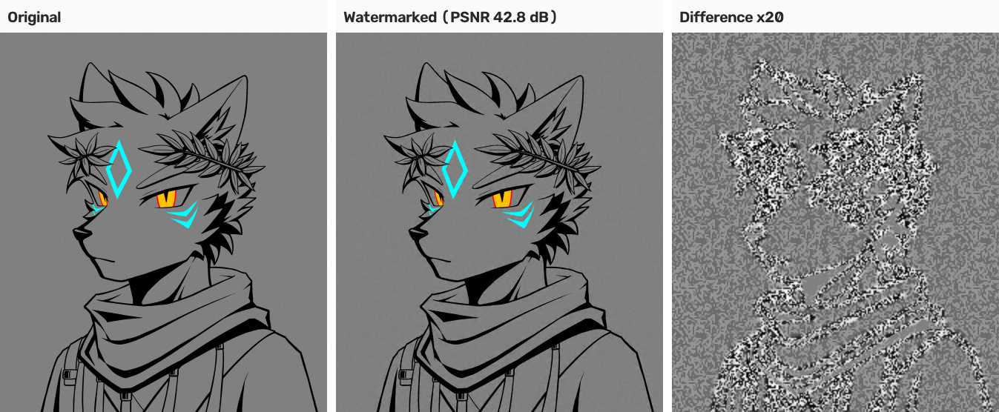
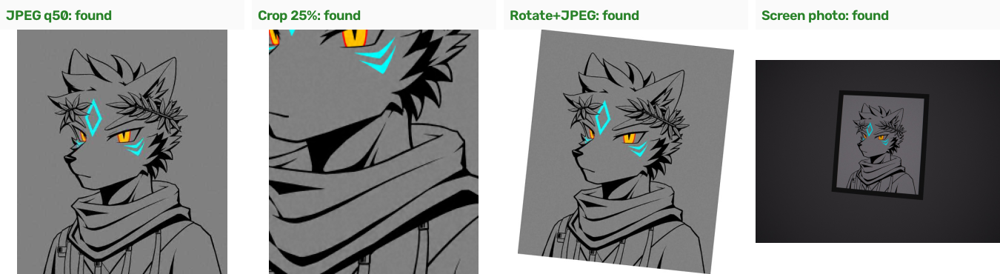
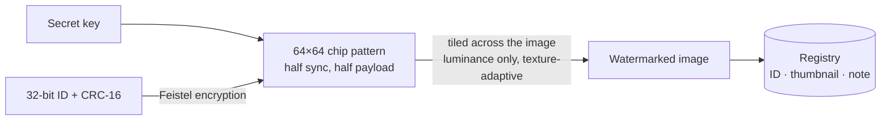

<div align="center">

# BlindMark

**Invisible, keyed watermarks that prove an image is yours — and show which copy leaked.**

Runs entirely offline · Collects no data · Your images never leave your computer

**English** | [简体中文](README.zh-CN.md)

[](https://github.com/lupo4085/blindmark/actions/workflows/build.yml)
[](https://github.com/lupo4085/blindmark/releases)

[](#license)

</div>



<p align="center"><sub>Left: original. Middle: watermarked (PSNR 42.8 dB; no pixel changes by more than 6 luminance levels). Right: the difference, amplified 20×. The mark follows lines and texture and stays light on flat areas.</sub></p>

> [!NOTE]
> The user interface is currently in Chinese. An English UI is planned for v0.4. The command-line tool works in any language.

---

## Contents

- [Why](#why)
- [Features](#features)
- [Live test: the image above](#live-test-the-image-above)
- [Download and install](#download-and-install)
- [Quick start](#quick-start)
- [Desktop app (Windows)](#desktop-app-windows)
- [Command line](#command-line)
- [Benchmarks](#benchmarks)
- [How it works](#how-it-works)
- [Limitations](#limitations)
- [Roadmap](#roadmap)
- [Project layout](#project-layout)
- [Contributing](#contributing)
- [License](#license)

## Why

Artists, photographers and designers who share their work run into two problems: someone reposts an image and there is no easy way to show it is yours, or a draft sent to several people leaks and there is no way to tell who shared it.

Visible watermarks spoil the picture and disappear with a crop. Online watermarking services need you to upload your originals. BlindMark takes a different approach:

- It hides an **invisible ID** in the image that usually survives reposting, compression, screenshots and rotation.
- **Only your key can read the ID.** Without the key, nobody can read or forge it.
- Every ID goes into your own **registry**: which original, when, and who it was for.
- Everything runs locally. **No network, no uploads.**

## Features

| Feature | Description |
|---|---|
| **Keyed blind watermark** | Detection needs only the key, not the original. One 32-bit ID per image, with a CRC check |
| **Near-lossless** | Changes luminance only, with strength adapted to texture. Typical PSNR above 40 dB |
| **Survives everyday handling** | JPEG / WebP compression, resizing, cropping, app UI frames, screenshots, any-angle rotation, mirroring |
| **Screen photos (experimental)** | Reads photos taken of a screen after a perspective correction guided by the registry |
| **Registry** | Records the original, note, time and thumbnail for each ID; searchable, exports to CSV |
| **Catches transplanted marks** | After reading an ID, compares the picture with the registered thumbnail to spot a mark moved onto another image |
| **One-click evidence export** | Report, SHA-256 of the suspect file, registered thumbnail and registry entry in one folder |
| **Getting-started wizard** | Walks you through creating a key, choosing a registry, watermarking and checking. Press F1 any time |
| **Native app** | Native Win32 UI on Windows (high-DPI aware); a single-binary CLI on all three platforms |
| **Python reference implementation** | Byte-for-byte compatible with the Rust build, with attack simulations and benchmark scripts |

**In development (v0.3):** per-recipient distribution (a separately numbered copy for each recipient) and optional trusted timestamps (off by default; only goes online when you turn it on). Currently on the `alpha` branch.

## Live test: the image above

This illustration is only 441×512 pixels, much smaller than the photos in the benchmark set, which makes it a hard case for a blind watermark.

```console
$ blindmark-cli keygen --key demo.key
wrote demo.key (fingerprint a65eb21f65bd) — back it up, never share it

$ blindmark-cli embed lupo.png --out marked --key demo.key --registry reg --channel "README demo"
{"id":"0xe308fb2a","input":"lupo.png","output":"marked/lupo_wm.png","psnr_db":42.84,"sec":0.025}

$ blindmark-cli detect marked/lupo_wm.png --key demo.key --registry reg
{"found":true,"id_hex":"0xe308fb2a","method":"crc","z_sync":34.9,"content_similarity":0.99996, ...}

$ blindmark-cli detect lupo.png --key demo.key --registry reg      # original, no watermark
{"found":false,"present":false, ...}
```

We then applied the same attacks to both the watermarked image and the **unwatermarked original**, five random runs each:



| Attack | Correct ID | Wrong ID | False positives on original |
|---|---|---|---|
| None | 5/5 | 0 | 0/5 |
| JPEG quality 75 / 50 | 5/5 / 5/5 | 0 | 0/10 |
| WebP quality 70 | 5/5 | 0 | 0/5 |
| Resize 0.5× / 0.75× / 1.5× | 5/5 / 5/5 / 5/5 | 0 | 0/15 |
| Crop to 50% / 25% of the area | 5/5 / 5/5 | 0 | 0/10 |
| App UI frame, gamma | 5/5 / 5/5 | 0 | 0/10 |
| Any-angle rotation (±30°) + JPEG 85 | 5/5 | 0 | 0/5 |
| Mirror, then screenshot | 5/5 | 0 | 0/5 |
| Screenshot, mild | 5/5 | 0 | 0/5 |
| Screenshot, typical (45–100% zoom, 40–90% captured, JPEG 65–90) | 1/5 | 0 | 0/5 |
| Screenshot, harsh (35–60% zoom, 30–60% captured, JPEG 55–75) | 0/5 | 0 | 0/5 |
| Simulated photo of a screen | 5/5 | 0 | 0/5 |

**Result:** 15 of 17 attacks were read every time. **Across all 85 tests on the original there were no false positives, and no run ever returned a wrong ID.** The screenshot failures come from the image's small size: shrunk to about 200 pixels, each tile is only about 50 pixels across, which carries too little signal. Larger images do much better on screenshots (see [Benchmarks](#benchmarks)).

The original and watermarked test images are in [`docs/images/`](docs/images/). To reproduce, build the CLI and run the commands above; the attacks are in [`python/attacks.py`](python/attacks.py) and [`python/photo_sim.py`](python/photo_sim.py).

## Download and install

### Prebuilt binaries (recommended)

Download the archive for your platform from [Releases](https://github.com/lupo4085/blindmark/releases):

| Platform | Contents |
|---|---|
| Windows | `blindmark.exe` (desktop app), `blindmark-cli.exe` (command line) |
| macOS / Linux | `blindmark-cli` (command line) |

The binaries are not code-signed yet:

- **Windows:** if SmartScreen blocks it, click "More info" → "Run anyway".
- **macOS:** run `xattr -d com.apple.quarantine blindmark-cli`.
- **macOS / Linux:** files downloaded from Actions artifacts lose the executable bit; run `chmod +x blindmark-cli` first.

### Build from source

Requires [Rust](https://rustup.rs) (2024 edition).

```bash
git clone https://github.com/lupo4085/blindmark.git
cd blindmark
cargo build --release
# Windows: target\release\blindmark.exe and blindmark-cli.exe
# macOS / Linux: target/release/blindmark-cli
```

You can also fork the repo and run the `build` workflow from the Actions tab; binaries for all three platforms appear under Artifacts a few minutes later. Pushing a version tag (e.g. `v0.3.0`) publishes a Release automatically.

## Quick start

**Windows desktop app**

1. Open `blindmark.exe`. On first launch a wizard walks you through: create a key → choose where to keep the registry → **back up your key**.
2. Choose "给图片加水印" (Watermark images), drop your pictures in and start. Watermarked copies are saved next to the originals by default.
3. When you find a suspicious copy online, open the 检测 (Detect) tab and **paste a screenshot with Ctrl+V**, or drop the file in.

**Command line**

```bash
blindmark-cli keygen --key my.key
blindmark-cli embed photos/*.jpg --out marked/ --key my.key --registry reg/ --channel "Instagram"
blindmark-cli detect suspect.jpg --key my.key --registry reg/
```

> [!IMPORTANT]
> **Back up your key file and your registry folder.** If you lose the key, you can never read your existing watermarks again. Never share the key with anyone.

## Desktop app (Windows)

A classic Win32 window with a menu bar, four tabs and a status bar (status · key fingerprint · registry size · version). High-DPI and per-monitor scaling are supported. Settings live in `%APPDATA%\blindmark\settings.json`; the key defaults to `%APPDATA%\blindmark\blindmark.key` and the registry to `registry\` in the same folder.

| Tab | What it does |
|---|---|
| **Watermark** | Add images or folders (or drag them onto the window); choose the output folder, a note (e.g. "Weibo", "for client X"; recent notes are remembered), strength and PNG / JPEG. Batches run in the background and can be stopped at any time |
| **Detect** | Open, drop, or **paste a screenshot with Ctrl+V**. A banner gives the verdict; a table lists ID, note, original file, registration time and picture similarity, with the registered thumbnail alongside. Copy a text report or export evidence |
| **Registry** | Search and filter by ID, file name or note; sort by column; edit notes, open the output location, export CSV |
| **Settings** | Key (new / choose / back up / remove), registry, watermark defaults, detection options, general options |

**Five possible verdicts:**

| Verdict | Meaning |
|---|---|
| Your watermark was found | Both the ID and the picture match |
| ID matches, picture does not | Someone may have moved your watermark onto another image |
| Watermark present, ID unreadable | Cropped too small or compressed too hard |
| Picture matches, no watermark read | Photo too blurry or skewed, or the unwatermarked original leaked |
| No watermark found | This does **not** prove the image isn't yours |

**Shortcuts:** F1 getting started (wizard), Ctrl+O add images, Ctrl+D detect, Ctrl+V detect from clipboard, Del remove selected, F5 refresh registry, Ctrl+1…4 switch tabs.

## Command line

```text
blindmark-cli keygen --key <keyfile>
blindmark-cli embed  <images...> --out <dir> --key <keyfile> [--registry <dir>]
                     [--strength 2.6] [--channel <note>] [--jpeg]
blindmark-cli detect <images...> --key <keyfile> [--registry <dir>]
```

`embed` and `detect` print one JSON line per image, so they are easy to script. Key fields in detection output:

| Field | Meaning |
|---|---|
| `found` | A definite ID was read |
| `id_hex` | The ID |
| `present` | Signs of a watermark were found (the ID may still be unreadable) |
| `method` | `crc`: decoded directly; `registry`: maximum-likelihood match against registered IDs |
| `content_similarity` | Picture match against the registered thumbnail, 0–1, threshold 0.6 |
| `z_sync` | Sync signal strength |

## Benchmarks

Simulated tests on 9 photos. The sample is small; treat the numbers as indicative.

**Everyday handling** (4 random runs per attack)

| Attack | Detection rate | Wrong ID | False positives |
|---|---|---|---|
| JPEG q50/q75, WebP q70, resize 0.5/0.75/1.5, gamma, UI frame | 100% | 0 | 0 |
| Crop to 50% / 25% | 97% / 89% | 0 | 0 |
| Screenshot, mild / typical | 97% / 100% | 0 | 0 |
| Screenshot, harsh | 33% | 0 | 0 |

**Rotation and mirroring** (3 runs per attack)

| Attack | Detection rate | Wrong ID | False positives |
|---|---|---|---|
| Any-angle rotation + JPEG 85 | 89% | 0 | 0 |
| Resize, partial capture, frame, rotate ±20°, JPEG 80 | 82% | 0 | 0 |
| Mirror, then screenshot | 93% | 0 | 0 |

- **Picture consistency:** genuine detections score above 0.78 (median 0.99); a watermark transplanted onto another image scores below 0.01.
- **Screen photos (experimental):** spot checks only. Simulated photos tilted 20° and 30° are read; photos taken from too far away are not.
- **Speed:** about 1.5 s to watermark a 24-megapixel photo; 1–2 s to detect, 3–4 s when rotation correction is needed (dual-core machine).

## How it works



1. **Embedding:** the key generates a 64×64 grid of ±1 chips, half sync code and half payload (32-bit ID + CRC-16, Feistel-encrypted). The grid is tiled across the image with a period of about a quarter of the short side.
2. **Detection:** autocorrelation gives the tile period (and so the scale); all tiles are folded into one and aligned by correlating with the sync code, then decoded. If the CRC fails, the detector does a maximum-likelihood match against registered IDs.
3. **Affine sync:** a tiled watermark stays a 2-D lattice under rotation, scaling and shear. Finding the lattice's two basis vectors in the whitened autocorrelation gives the transform; all 8 symmetries of the square tile are then tried.
4. **Screen-photo correction:** ORB features match the photo against registry thumbnails, RANSAC estimates the perspective, and the photo is rectified before reading. Needs the registry, but not the original.
5. **Picture consistency:** the suspect image is aligned to the registered thumbnail; flat regions are skipped and the median block correlation is taken.

The `blindmark/v1` format is frozen: every future version will read watermarks made today.

## Limitations

- The periodic structure from tiling can be found without the key; a determined attacker can average the tiles within one image to estimate and remove the mark.
- Does not survive AI redraws or style transfer.
- Small images shrunk heavily cannot be read (see the live test above).
- Screen-photo detection is experimental and depends on the registry.
- Very dark images with large flat areas can fail when also stretched or sheared.
- A watermark is one piece of evidence, not all of it. To claim ownership, keep the original, the registry and the detection results.

## Roadmap

- [x] v0.2: Win32 desktop app, affine sync (rotation / mirroring), screen-photo correction
- [x] v0.3-alpha: getting-started wizard, shared `jobs.rs` logic
- [ ] v0.3: per-recipient distribution, optional trusted timestamps, mnemonic key backup, calibrated false-positive rate
- [ ] v0.4: English UI, web detector (WASM; images never uploaded), winget / Scoop
- [ ] v0.5: optional neural detection boost (ONNX, CPU only)

## Project layout

```text
src/keys.rs       key derivation, chip patterns, payload encryption (byte-identical to Python)
src/wm.rs         embedding and standard detection
src/affine.rs     affine sync for rotation, mirroring and shear
src/features.rs   ORB features and RANSAC perspective (screen photos)
src/registry.rs   registry, image I/O, picture consistency check
src/jobs.rs       background watermark and detect jobs (shared by app and wizard)
src/imgproc.rs    filtering, resizing, FFT
src/win/          Win32 desktop app and wizard
src/bin/cli.rs    command line
python/           Python reference implementation, attack simulations, benchmarks
docs/             architecture, UI specs, task cards
```

## Contributing

Issues and pull requests are welcome. Before you start, please read:

- [`AGENTS.md`](AGENTS.md): ground rules (no watermark format changes, no new network access, no casual new dependencies)
- [`docs/ARCHITECTURE.md`](docs/ARCHITECTURE.md): module responsibilities and state ownership
- [`docs/specs/`](docs/specs/): UI and copy specifications

Please run `cargo fmt`, `cargo clippy` and `cargo test` before submitting.

## License

The code is dual-licensed under **MIT or Apache-2.0**, at your option: [MIT](LICENSE-MIT) · [Apache-2.0](LICENSE-APACHE).

Unless you explicitly state otherwise, any contribution you intentionally submit to this project is dual-licensed as above, without any additional terms or conditions.

The demo illustration in `docs/images/` is © 洛凌寒 (Rasen), used for demonstration only, and is not covered by the code license above.
