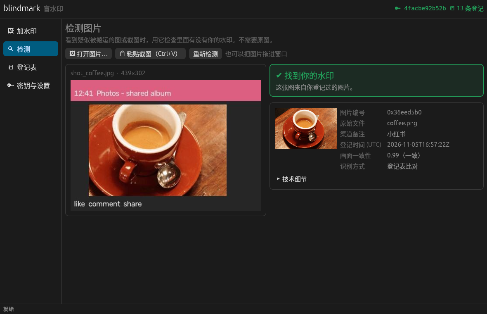

# blindmark（Rust 版）

带密钥、内容自适应、能扛截图的盲水印，带图形界面。算法和 Python 参考实现（`python/` 目录）逐字节一致：同一把密钥、同一个登记表可以混用，两边加的水印都能互相检测。



## 获取程序

**方式一：用 GitHub 自动编译（推荐，不用装 Rust）**
1. 把整个文件夹推到你自己的 GitHub 仓库，设成私有也可以。
2. 打开仓库的 Actions 页面，选择 `build` → `Run workflow`，或者推一个 `v0.1.0` 这样的标签。
3. 几分钟后就能下载 Windows、macOS（Apple 芯片）和 Linux 的可执行文件。

**方式二：自己编译**
```bash
# 先在 https://rustup.rs 安装 Rust
cargo build --release
# 生成的程序：target/release/blindmark（图形界面）和 blindmark-cli（命令行）
```

macOS 首次打开未签名程序时会被拦截：右键点程序选"打开"，或者运行 `xattr -d com.apple.quarantine blindmark`。

## 图形界面

| 页面 | 作用 |
|---|---|
| 🔑 密钥与设置 | 新建或选择私钥；选择登记表文件夹。登记表会记住它属于哪把密钥，配错了会提示 |
| 🖼 加水印 | 拖入图片或文件夹，填渠道备注（比如"微博""发给某客户"），调强度，批量输出到指定文件夹并自动登记 |
| 🔍 检测 | 拖入图片、打开文件，或者直接 **Ctrl+V 粘贴截图**。显示编号、原始文件、渠道、登记时间，以及和登记原图的画面一致性 |
| 📒 登记表 | 浏览和搜索所有已发出的编号，查看缩略图和哈希 |

检测结果分四种：
- ✔ **找到你的水印**：编号和画面都对得上。
- ⚠ **编号对上了，但画面不一致**：可能有人把你的水印搬到了另一张图上（见 `docs/detect_transplant.png`）。
- ⚠ **检测到水印，但无法确定是哪张**：截得太小或压缩太狠。
- ✕ **未检测到**：这不能证明图不是你的。

## 命令行

```bash
blindmark-cli keygen --key my.key
blindmark-cli embed photos/*.jpg --out marked/ --key my.key --registry reg/ --channel "微博"
blindmark-cli detect suspect.jpg --key my.key --registry reg/      # 每张图输出一行 JSON
```

## 测试结果（9 张测试图，每种随机攻击跑 4 次）

| 攻击 | 识别率 | 认错 ID | 未加水印图误报 |
|---|---|---|---|
| JPEG q50/q75、WebP q70、缩放 0.5/0.75/1.5、伽马、加 UI 边框 | 100% | 0 | 0 |
| 裁剪保留 50% / 25% | 97% / 89% | 0 | 0 |
| 截图·轻度 / 常见 | 97% / 100% | 0 | 0 |
| 截图·严苛（缩到 0.35–0.6、只截 30–60%、JPEG 55–75） | 33% | 0 | 0 |

**画面一致性检查**：正常检出的图（包括截图）都在 0.95 以上；把水印移植到别的图上，结果在 0.01 以下。判定阈值是 0.6。

**速度**：一张 2400 万像素的照片，加水印 1.5 秒，检测 1.7 秒；截图检测通常不到 1 秒。

## 原理

1. 由私钥生成 64×64 的 ±1 码片网格：一半是同步码，另一半承载载荷。载荷是 32 位编号加 CRC-16，用 Feistel 加密。
2. 码片网格平铺到全图，周期约为短边的 1/4，只改亮度通道，嵌入强度跟随纹理和亮度变化。
3. 检测时：用白化和未白化的自相关估计平铺周期（也就得到了缩放比例），把各个周期折叠成一块，和同步码做相关来对齐，然后先直接解码（CRC 校验），失败时再在登记过的编号里做最大似然匹配。
4. 画面一致性：用估计出的缩放比例加相位相关，把可疑图对齐到登记的缩略图上，跳过平坦区域，取各分块相关系数的中位数。

## 局限

- 平铺带来的周期结构，没有密钥也能被发现，别人可以在单张图内把各块叠加平均来估计并去除水印。
- 不抗旋转和翻转，不抗对着屏幕拍照，也不抗 AI 重绘。
- 主张所有权时，要同时保留原图、登记表（最好对登记表做可信时间戳）和检测结果。
- **一定要备份私钥和登记表文件夹。** 丢了私钥就再也检测不出自己的水印。

## 目录

```
src/keys.rs       密钥派生、码片图样、载荷加密（与 Python 逐字节一致，有测试向量）
src/imgproc.rs    滤波、缩放、FFT（边界和插值方式与 OpenCV 一致）
src/wm.rs         嵌入与检测
src/registry.rs   登记表（JSON，与 Python 版兼容）、图片读写、画面一致性检查
src/main.rs       图形界面（egui）
src/bin/cli.rs    命令行
python/           Python 参考实现与评测脚本
.github/workflows 三平台自动编译
```
