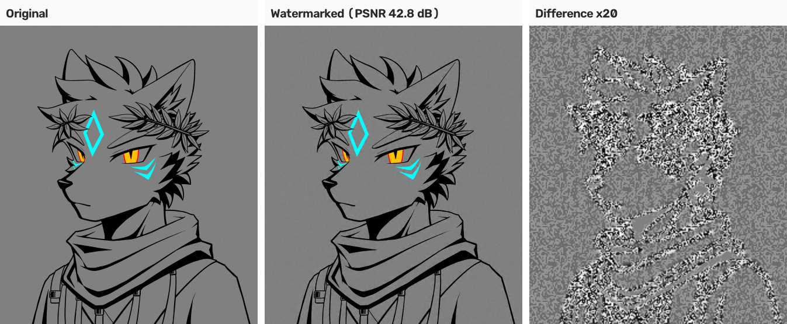
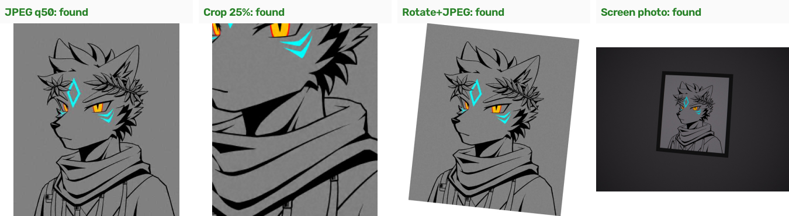
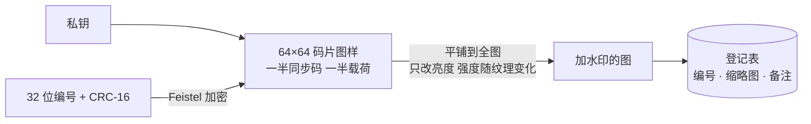

<div align="center">

# BlindMark

**给图片加上肉眼看不见的水印，证明图片是你的，并查出是从哪一份流出去的。**

完全本地运行 · 不收集任何数据 · 图片不会离开你的电脑

[English](README.md) | **简体中文**

[](https://github.com/lupo4085/blindmark/actions/workflows/build.yml)
[](https://github.com/lupo4085/blindmark/releases)

[](#许可证)

</div>



<p align="center"><sub>左：原图。中：加水印后（PSNR 42.8 dB，像素最多改动 6 级亮度）。右：两者的差异放大 20 倍。水印跟着线条和纹理走，平坦区域改得少。</sub></p>

---

## 目录

- [为什么做这个](#为什么做这个)
- [功能](#功能)
- [实测：用上面这张图跑一遍](#实测用上面这张图跑一遍)
- [下载和安装](#下载和安装)
- [快速上手](#快速上手)
- [图形界面（Windows）](#图形界面windows)
- [命令行](#命令行)
- [评测结果](#评测结果)
- [原理](#原理)
- [局限](#局限)
- [路线图](#路线图)
- [目录结构](#目录结构)
- [参与开发](#参与开发)
- [许可证](#许可证)

## 为什么做这个

画师、摄影师和设计师把图发出去以后，常常遇到两件事：图被人拿去用了，说不清是自己的；发给好几个人的稿子流出去了，不知道是谁传的。

可见水印会破坏画面，而且一裁就掉。在线水印服务要把原图上传到别人的服务器。BlindMark 的做法是：

- 在图片里加入**看不见的编号**。图片经过转发、压缩、截图、旋转后，通常仍然能读出来。
- **编号只有你的密钥能读出**，别人拿不到你的密钥，就伪造不了、也读不出。
- 每个编号记在你自己的**登记表**里：哪张原图、什么时候、发给谁。
- 所有处理都在本地完成，**不联网、不上传**。

## 功能

| 功能 | 说明 |
|---|---|
| **带密钥的盲水印** | 检测不需要原图，只要密钥。每张图一个 32 位编号，带 CRC 校验 |
| **画质几乎无损** | 只改亮度通道，强度随纹理自适应，典型 PSNR 在 40 dB 以上 |
| **扛得住常见处理** | JPEG / WebP 压缩、缩放、裁剪、加 UI 边框、截图、任意角度旋转、镜像 |
| **拍屏检测（实验性）** | 对着屏幕拍的照片，借助登记表做透视校正后再读取 |
| **登记表** | 记录每个编号对应的原图、备注、时间和缩略图，可搜索、导出 CSV |
| **防“搬运”误判** | 检出编号后，再把画面和登记的缩略图比对，发现有人把水印移到了别的图上 |
| **一键导出证据** | 检测报告、可疑文件的 SHA-256、登记缩略图和登记记录打包到一个文件夹 |
| **新手向导** | 首次启动带你完成创建密钥、选择登记表、加水印、检查图片；随时按 F1 打开 |
| **原生程序** | Windows 是原生 Win32 界面（支持高 DPI），三个平台都有命令行版，单个可执行文件 |
| **Python 参考实现** | 和 Rust 版逐字节互通，自带攻击模拟和评测脚本 |

**开发中（v0.3）**：接收人分发（给每位接收人生成一份独立编号的副本）、可选的可信时间戳（默认关闭，手动开启才联网）。目前在 `alpha` 分支。

## 实测：用上面这张图跑一遍

这张插画只有 441×512 像素，比评测集里的照片小很多，对盲水印来说是偏难的情况。

```console
$ blindmark-cli keygen --key demo.key
wrote demo.key (fingerprint a65eb21f65bd) — back it up, never share it

$ blindmark-cli embed lupo.png --out marked --key demo.key --registry reg --channel "README demo"
{"id":"0xe308fb2a","input":"lupo.png","output":"marked/lupo_wm.png","psnr_db":42.84,"sec":0.025}

$ blindmark-cli detect marked/lupo_wm.png --key demo.key --registry reg
{"found":true,"id_hex":"0xe308fb2a","method":"crc","z_sync":34.9,"content_similarity":0.99996, ...}

$ blindmark-cli detect lupo.png --key demo.key --registry reg      # 没加水印的原图
{"found":false,"present":false, ...}
```

然后对加水印的图和**没加水印的原图**各做同样的处理，每种处理随机跑 5 次：



| 处理 | 识别出正确编号 | 认错编号 | 原图误报 |
|---|---|---|---|
| 不处理 | 5/5 | 0 | 0/5 |
| JPEG 质量 75 / 50 | 5/5 / 5/5 | 0 | 0/10 |
| WebP 质量 70 | 5/5 | 0 | 0/5 |
| 缩放 0.5× / 0.75× / 1.5× | 5/5 / 5/5 / 5/5 | 0 | 0/15 |
| 裁剪，只保留 50% / 25% 面积 | 5/5 / 5/5 | 0 | 0/10 |
| 加 App 界面边框、调伽马 | 5/5 / 5/5 | 0 | 0/10 |
| 任意角度旋转（±30°）+ JPEG 85 | 5/5 | 0 | 0/5 |
| 左右镜像后再截图 | 5/5 | 0 | 0/5 |
| 截图·轻度 | 5/5 | 0 | 0/5 |
| 截图·常见（缩到 45–100%，截 40–90%，JPEG 65–90） | 1/5 | 0 | 0/5 |
| 截图·严苛（缩到 35–60%，截 30–60%，JPEG 55–75） | 0/5 | 0 | 0/5 |
| 模拟对着屏幕拍照 | 5/5 | 0 | 0/5 |

**结论**：17 种处理里 15 种全部识别；**全部 85 次原图测试零误报，也没有一次认错编号**。截图失败的主要原因是这张图本来就小，再缩小到 200 像素左右，单个平铺块只剩 50 多像素，信息不够。原尺寸更大的图片在截图测试里表现好得多（见下面的[评测结果](#评测结果)）。

测试用的原图和加水印后的图都在 [`docs/images/`](docs/images/) 里。复现方法：编译后运行上面的命令，攻击函数在 [`python/attacks.py`](python/attacks.py) 和 [`python/photo_sim.py`](python/photo_sim.py)。

## 下载和安装

### 直接下载（推荐）

到 [Releases](https://github.com/lupo4085/blindmark/releases) 下载对应平台的压缩包：

| 平台 | 包含 |
|---|---|
| Windows | `blindmark.exe`（图形界面）、`blindmark-cli.exe`（命令行） |
| macOS / Linux | `blindmark-cli`（命令行） |

程序目前没有代码签名：

- **Windows**：SmartScreen 拦截时，点“更多信息”→“仍要运行”。
- **macOS**：运行 `xattr -d com.apple.quarantine blindmark-cli`。
- **macOS / Linux**：从 Actions 的 Artifacts 下载的文件会丢失可执行权限，先运行 `chmod +x blindmark-cli`。

### 自己编译

需要 [Rust](https://rustup.rs)（2024 edition）。

```bash
git clone https://github.com/lupo4085/blindmark.git
cd blindmark
cargo build --release
# Windows：target\release\blindmark.exe 和 blindmark-cli.exe
# macOS / Linux：target/release/blindmark-cli
```

也可以 fork 仓库后在 Actions 页面运行 `build` 工作流，几分钟后在 Artifacts 里下载三个平台的程序。推一个版本标签（如 `v0.3.0`）会自动发布 Release。

## 快速上手

**Windows 图形界面**

1. 打开 `blindmark.exe`。第一次启动会弹出向导：创建密钥 → 选择登记表位置 → **备份密钥**。
2. 选“给图片加水印”，把图片拖进去，点“开始加水印”。带水印的副本默认和原图放在同一个文件夹。
3. 在网上发现可疑图片时，打开“检测”选项卡，**Ctrl+V 粘贴截图**，或者把文件拖进去。

**命令行**

```bash
blindmark-cli keygen --key my.key
blindmark-cli embed photos/*.jpg --out marked/ --key my.key --registry reg/ --channel "微博"
blindmark-cli detect suspect.jpg --key my.key --registry reg/
```

> [!IMPORTANT]
> **一定要备份密钥文件和登记表文件夹。** 丢了密钥，就再也读不出已经加过的水印。密钥不要发给任何人。

## 图形界面（Windows）

经典 Win32 窗口：菜单栏、四个选项卡、底部状态栏（当前状态 · 密钥指纹 · 登记表条数 · 版本）。支持高 DPI 和多显示器缩放。设置保存在 `%APPDATA%\blindmark\settings.json`，密钥默认在 `%APPDATA%\blindmark\blindmark.key`，登记表在同目录的 `registry\`。

| 选项卡 | 作用 |
|---|---|
| **加水印** | 添加图片或文件夹（可以直接拖进窗口），设置输出文件夹、备注（比如“微博”“发给某客户”，会记住用过的）、强度、PNG / JPEG。后台批量处理，可以随时停止 |
| **检测** | 打开、拖入，或者 **Ctrl+V 粘贴截图**。上方给出结论，表格列出编号、备注、原始文件、登记时间、画面相似度，右侧显示登记时的缩略图。可以复制文字报告，或“导出证据…” |
| **登记表** | 按编号、文件名、备注搜索和筛选，点列标题排序。可以修改备注、打开输出位置、导出 CSV |
| **设置** | 密钥（新建 / 选择 / 备份 / 移除）、登记表、加水印默认值、检测选项、常规选项 |

**检测结果分五种：**

| 结论 | 含义 |
|---|---|
| 找到你的水印 | 编号和画面都对得上 |
| 编号对上了，但画面不一致 | 可能有人把你的水印搬到了另一张图上 |
| 检测到水印，但无法确定是哪张 | 截得太小或压缩太狠 |
| 画面和登记的图一致，但没有读出水印 | 拍得太糊、太斜，或者流出的是没加水印的原图 |
| 没有找到你的水印 | 这**不能**证明图不是你的 |

**快捷键**：F1 开始使用（向导），Ctrl+O 添加图片，Ctrl+D 检测图片，Ctrl+V 从剪贴板检测，Del 移除所选，F5 刷新登记表，Ctrl+1…4 切换选项卡。

## 命令行

```text
blindmark-cli keygen --key <密钥文件>
blindmark-cli embed  <图片...> --out <文件夹> --key <密钥文件> [--registry <文件夹>]
                     [--strength 2.6] [--channel <备注>] [--jpeg]
blindmark-cli detect <图片...> --key <密钥文件> [--registry <文件夹>]
```

`embed` 和 `detect` 每张图输出一行 JSON，方便接进脚本。检测结果里的主要字段：

| 字段 | 含义 |
|---|---|
| `found` | 是否读出了确定的编号 |
| `id_hex` | 编号 |
| `present` | 是否有水印存在的迹象（可能读不出具体编号） |
| `method` | `crc` 直接解码成功；`registry` 在登记表里做最大似然匹配 |
| `content_similarity` | 和登记缩略图的画面一致性，0–1，阈值 0.6 |
| `z_sync` | 同步信号强度 |

## 评测结果

9 张测试照片上的模拟测试（样本量不大，只作参考）。

**常规处理**（每种随机跑 4 次）

| 处理 | 识别率 | 认错编号 | 原图误报 |
|---|---|---|---|
| JPEG q50/q75、WebP q70、缩放 0.5/0.75/1.5、伽马、加界面边框 | 100% | 0 | 0 |
| 裁剪保留 50% / 25% | 97% / 89% | 0 | 0 |
| 截图·轻度 / 常见 | 97% / 100% | 0 | 0 |
| 截图·严苛 | 33% | 0 | 0 |

**旋转和翻转**（每种跑 3 次）

| 处理 | 识别率 | 认错编号 | 原图误报 |
|---|---|---|---|
| 任意角度旋转 + JPEG 85 | 89% | 0 | 0 |
| 缩放、截取、加边框，再旋转 ±20°，JPEG 80 | 82% | 0 | 0 |
| 左右镜像后再截图 | 93% | 0 | 0 |

- **画面一致性**：正常检出的图在 0.78 以上，中位数 0.99；把水印移植到别的图上，结果低于 0.01。
- **拍屏（实验性）**：只做了抽查。倾斜 20°、30° 的模拟拍屏能读出编号；拍得太远、太小时读不出。
- **速度**：2400 万像素的照片加水印约 1.5 秒；检测 1–2 秒，需要旋转校正时 3–4 秒（双核机器）。

## 原理



1. **嵌入**：由私钥生成 64×64 的 ±1 码片网格，一半是同步码，一半承载载荷（32 位编号 + CRC-16，Feistel 加密）。网格平铺到全图，周期约为短边的 1/4。
2. **常规检测**：用自相关估计平铺周期（得到缩放比例），把各个周期折叠成一块，和同步码做相关来对齐，然后直接解码；CRC 不通过时，在登记过的编号里做最大似然匹配。
3. **仿射同步**：平铺的水印在旋转、缩放、拉伸后仍然是二维点阵，从白化自相关图里找到点阵的两个基向量，就得到了变换。还原后把方块的 8 种对称姿态都试一遍。
4. **拍屏校正**：用 ORB 特征点把照片和登记表里的缩略图匹配，RANSAC 估计透视变换，拉正后再读。需要登记表，但不需要原图。
5. **画面一致性**：把可疑图对齐到登记缩略图，跳过平坦区域，取分块相关系数的中位数。

水印格式 `blindmark/v1` 已冻结：以后任何版本都能读出现在加的水印。

## 局限

- 平铺带来的周期结构，没有密钥也能被发现；懂行的人可以在单张图内把各块叠加平均来估计并去除水印。
- 不抗 AI 重绘、风格迁移。
- 很小的图在被大幅缩小后读不出来（见上面的实测）。
- 拍屏检测是实验性的，依赖登记表。
- 很暗、大片纯色的图片在同时被拉伸或错切时容易失败。
- 水印是证据之一，不是全部。主张所有权时，要同时保留原图、登记表和检测结果。

## 路线图

- [x] v0.2：Win32 图形界面、仿射同步（旋转 / 镜像）、拍屏校正
- [x] v0.3-alpha：新手向导、`jobs.rs` 共用逻辑
- [ ] v0.3：接收人分发、可选的可信时间戳、密钥助记词备份、经过标定的误报率
- [ ] v0.4：英文界面、网页版检测器（WASM，图片不上传）、winget / Scoop
- [ ] v0.5：可选的神经网络增强检测（ONNX，只用 CPU）

## 目录结构

```text
src/keys.rs       密钥派生、码片图样、载荷加密（与 Python 逐字节一致）
src/wm.rs         嵌入与常规检测
src/affine.rs     旋转、翻转、拉伸的仿射同步
src/features.rs   ORB 特征点、RANSAC 透视估计（拍屏校正用）
src/registry.rs   登记表、图片读写、画面一致性检查
src/jobs.rs       加水印和检测的后台任务（界面和向导共用）
src/imgproc.rs    滤波、缩放、FFT
src/win/          Win32 图形界面和向导
src/bin/cli.rs    命令行
python/           Python 参考实现、攻击模拟、评测脚本
docs/             架构、界面规格、任务卡
```

## 参与开发

欢迎提 issue 和 pull request。动手之前请先读：

- [`AGENTS.md`](AGENTS.md)：开发规则（不改水印格式、不新增联网行为、不随意加依赖）
- [`docs/ARCHITECTURE.md`](docs/ARCHITECTURE.md)：模块分工和状态归属
- [`docs/specs/`](docs/specs/)：界面和文案规格

提交前请运行 `cargo fmt`、`cargo clippy` 和 `cargo test`。

## 许可证

代码采用 **MIT 或 Apache-2.0 双许可**，任选其一：[MIT](LICENSE-MIT) · [Apache-2.0](LICENSE-APACHE)。

除非你明确声明，否则你有意提交给本项目的任何贡献，都将以上述双许可发布，不附加其他条款。

`docs/images/` 里的示例插画版权归洛凌寒（Rasen）所有，仅用于演示，不适用上述代码许可证。
