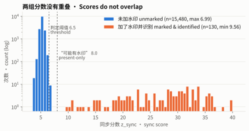
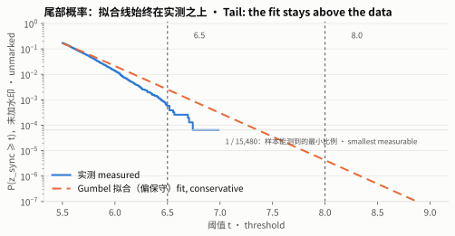
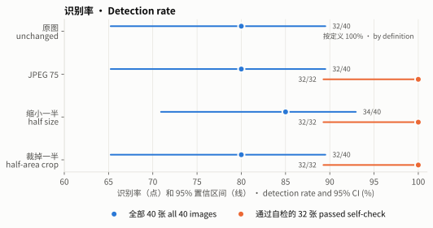

# 统计证据（误报率、识别率、认错编号）

由 `python/calib_stats.py` 生成，随机种子 20261110。置信区间都是 95%。
bootstrap 按图片整组重抽（同一张图的多把密钥、多个版本彼此相关）。

图由 `python/calib_plots.py` 生成。

## 1. 把未加水印的图误判为“这是你的图片”

- 负样本：523 张图（照片、插画、截图、合成图），15690 次检测，每张图 × 3 个版本 × 10 把密钥。
- **实测：0 次误判。** 这里阈值放到负无穷，每次都走完 CRC 和登记表匹配两步。
- 只凭实测能给出的上界：每次检测 ≤ 1.9e-04；如果把同一张图的所有检测算作一次，每张图 ≤ 5.8e-03。
  这两个数只说明样本量有限，不代表真实误报率这么高。
- **模型估计**：一次误判必须同时满足两件事：
  1. 同步分数 z ≥ 6.5；
  2. 48 位读数恰好通过 CRC-16（概率 2⁻¹⁶），或者恰好通过登记表规则（按设计 ≤ 1e-06）。
  未加水印的图里，读出的位是噪声，和 z 无关，所以两个概率可以相乘。
  实测 CRC 碰巧通过 0 次，按 2⁻¹⁶ 应为 0.24 次（全为 0 的概率 0.79），和理论一致。
- P(z ≥ 6.5)：实测 5.8e-04。Gumbel 拟合 2.5e-03，bootstrap 上界 3.1e-03。
- Gumbel 拟合在尾部**偏保守**，预测的超标次数在每个阈值都多于实测：

| 阈值 | 实测超过次数 | Gumbel 预测次数 |
|---|---|---|
| 6.0 | 205 | 329.6 |
| 6.25 | 43 | 114.1 |
| 6.5 | 9 | 39.3 |
| 6.75 | 1 | 13.5 |
| 7.0 | 0 | 4.6 |

- **结论：每次检测误判的概率 ≤ 5e-08**，也就是 3.1e-03 × (2⁻¹⁶ + 10⁻⁶)。
  按最保守的拟合（Gumbel 最大似然，尾部更重）算，也低于 10⁻⁶。

## 2. 读不出编号时，提示“可能有你的水印”

- 门槛 z ≥ 8.0。实测 0 / 15480 次，未加水印的图 z 最大为 6.99。
- Gumbel 估计 4.2e-06，bootstrap 上界 6.8e-06。

## 3. 识别率（加了水印的图）

40 张图，每张一把随机密钥，登记表里有 1000 个编号，其中包含真实编号。“识别”指找到并且编号正确。

| 版本 | 全部图片 | 加完水印能读出的图（通过自检） |
|---|---|---|
| orig | 32/40 = 80.0% [65.2%, 89.5%] | 100%（按定义） |
| jpeg75 | 32/40 = 80.0% [65.2%, 89.5%] | 32/32 = 100.0% [89.3%, 100.0%] |
| half | 34/40 = 85.0% [70.9%, 92.9%] | 32/32 = 100.0% [89.3%, 100.0%] |
| crop50 | 32/40 = 80.0% [65.2%, 89.5%] | 32/32 = 100.0% [89.3%, 100.0%] |

版本说明：orig 是加完水印不做处理；jpeg75 是 JPEG 质量 75；half 是缩小一半；crop50 是居中裁掉一半面积。所有图长边不超过 1600 像素。

加完水印就读不出的 8 张：
- 大部分是几乎全黑或全白的截图、大面积纯色的图，图片本身装不下水印。
- 1 张 640×428 的小照片。
- 1 张带点阵背景的插画，原因还在查。
V3-6c 的自检会在加水印时提示用户。
只要加完能读出，这批图在三种处理后全部能识别。

## 4. 认错编号

- 实测：0 / 130 次识别认错编号。只凭实测给出的上界是 2.3%。
- 按设计：登记表匹配规则的误配概率 ≤ 1e-06 每次检测，由二项分布精确计算（V3-6b）。
  CRC 路径认错编号，需要读出的 48 位错成另一个合法码字，概率约为 2⁻¹⁶ 乘以出错概率。
- 旧规则在同样的数据上认错 5 次，V3-6b 修复后为 0 次。

## 5. 分数间隔

能识别的水印图，z 最低 9.56；未加水印的图，z 最高 6.99。两组没有重叠。

## 局限
- 正样本只有 40 张，识别率的置信区间较宽。处理方式只有 4 种温和的，不含截图、旋转、拍屏，这些见 README 的评测表。
- 所有图长边不超过 1600 像素，水印强度为默认值 2.6。
- 标定用的是 `wm::detect_luma`。程序在有登记表缩略图时还会多试一条拍屏校正路径，相当于多一次机会，误报率上界大约翻倍，仍远低于 10⁻⁶。
